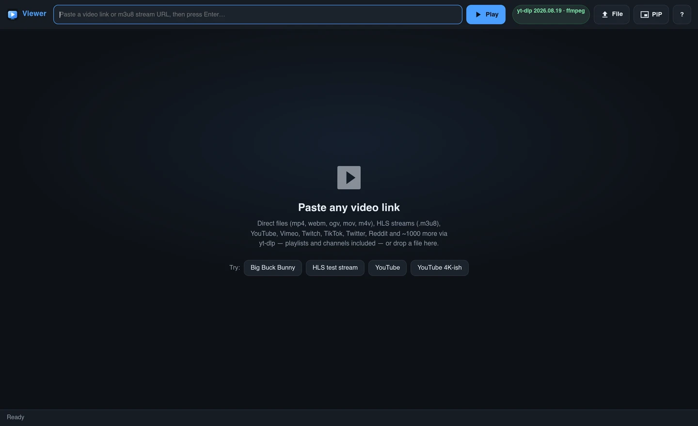
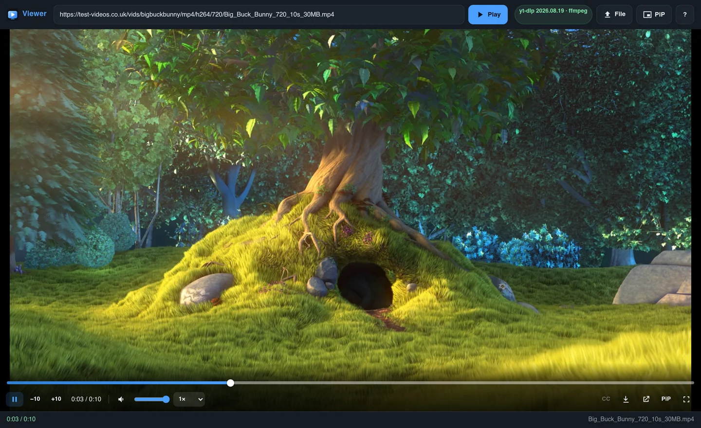

<p align="center">
  
</p>

<h1 align="center">Viewer</h1>

<p align="center">
  Paste any video link and watch it — direct files, HLS streams and ~1,000 yt-dlp sites in one clean player.
</p>

<p align="center">
  
</p>

<p align="center">
  <em>Browser-only for direct files and embeds. Add the Python backend to resolve YouTube, Vimeo, TikTok,
  Reddit, playlists and the hosts that only give their streams to a real browser session.</em>
</p>

## Why this exists

Most "universal players" break on the same three things: cross-origin CDNs that
demand a `Referer` or `Cookie`, signed URLs that expire mid-playback, and sites
whose player is intentionally obfuscated. Viewer handles all three on the server
side, then keeps the browser on a single origin.

- **Paste and play** — MP4/WebM/MOV, HLS (`.m3u8`), YouTube, Vimeo, Twitch,
  TikTok, Twitter/X, Reddit, Facebook, Tumblr, anime/18+ tube sites and more.
- **Real control bar** — precise seeking by typing a time, ±10 s, speed,
  captions, picture-in-picture, fullscreen, keyboard shortcuts.
- **Server-side proxy** — replays the headers a CDN requires, rewrites HLS
  playlists and keys, refreshes expired links, and explains failures in plain
  language instead of silently showing a black box.
- **Download** — saves through the backend even when the CDN blocks the browser.
- **No third-party assets** — hls.js is vendored and served locally, so ad
  blockers and DNS filters cannot kill playback.

## Screenshots



## Quick start

```bash
python3 server.py                    # http://localhost:8080
python3 server.py --port 8090        # custom port
python3 server.py --cookies cookies.txt   # age/geo-gated sites
python3 server.py --token secret     # require a token on every /api call
python3 server.py --install          # (re)download standalone yt-dlp
```

Open <http://localhost:8080/> — the frontend is served by the same process, so
there is no CORS setup. `PORT` and `HOST` are honoured.

Requires Python 3.10+ and `pip install -r requirements.txt`. `ffmpeg` is optional
but enables merging split video/audio streams; if it is not on `PATH`,
`imageio-ffmpeg` supplies one.

### Verify a change

```bash
python3 tools/backend_check.py   # proxy, HLS, adapters, cache, token, limits
python3 tools/wsgi_check.py      # the same handler through WSGI
```

Frontend tests (after touching `app.js` or the markup):

```bash
cd tools && npm install && cd ..
NODE_PATH=tools/node_modules node tools/ui_check.js           # UI behaviour
NODE_PATH=tools/node_modules node tools/integration_check.js  # end-to-end
```

For a single stubborn site, run the probe on the machine that runs the server:

```bash
python3 tools/site_check.py                      # every host in the edge suite
python3 tools/site_check.py https://host/video   # just that URL
```

It reports whether the host answers, how many formats were found, which ones
need the proxy, and the error otherwise — structure only, never titles or media.

## How it plays "hard" sites

A `<video>` element and hls.js can only send `Origin` and `User-Agent` to a
cross-origin host. Several layers make up the difference:

1. **`/api/info`** reports every format plus `needsProxy` — true as soon as the
   host wants more than a plain user agent.
2. **`/api/play?...&proxy=1`** re-fetches the bytes with the required headers,
   `Range` and seeking included. **`/api/hls`** does the same for adaptive
   streams and rewrites every segment, `EXT-X-KEY` and `EXT-X-MAP` URI back
   through this server, from master playlist to media playlist to segments.
3. **Expired links** are re-extracted with yt-dlp and retried once, silently.
4. **Honest errors** — if a host answers with a web page instead of media, the
   UI says why (expired, cookies needed, region-locked) instead of showing a
   broken player.
5. **Fallbacks** — when extraction fails, the error box offers the original page
   in a new tab (`rel="noopener noreferrer"`) and a prefilled **Submit a report**
   draft. Nothing is published without the user pressing GitHub's submit button.
6. **Embeds** — a site whose own player cannot be reduced to a media URL (a
   live browser challenge) is offered as its player frame instead; the server
   says `embed` in `/api/info` and the page loads it in the embedded player,
   never in `<video>`.

Additional behaviour worth knowing:

- `--impersonate chrome` (automatic when `curl_cffi` is installed) gets past
  Cloudflare/DataDome checks on datacenter IPs. It is retried without
  impersonation if rejected, then switched off after repeated failures.
- `--age-limit 18`, cookies, retries, socket timeouts and a shared yt-dlp cache
  directory are always on.
- The extraction cache is stamped with the server file's build time, so editing
  an adapter invalidates stale entries on the next restart instead of waiting
  out the TTL.
- Playlists, channels and profile pages are detected and listed in the UI.
- The proxy never follows a redirect off the host the media was resolved on
  (max 5 hops). Tune with `VIEWER_MAX_REDIRECTS`, or allow another CDN family
  with `VIEWER_REDIRECT_HOSTS=a.com,b.com`.
- `VIEWER_ALWAYS_PROXY=1` (or the checkbox in the quality panel) keeps the
  browser off CDNs entirely.
- UI errors are echoed to `/api/ui-log` and rate-limited, so "it doesn't play"
  becomes a diagnosable server log line.

### Site adapters

A few hosts have no usable generic extraction, so `server.py` keeps one explicit
adapter per site rather than guessing at page shapes:

| Host | What the adapter does |
| --- | --- |
| `hanime.tv` | Runs the player's signed handshake: executes the site's WebAssembly signer in wasmtime, seals `{timestamp, directive, slug}` with the site's key, POSTs it to `auth.hanime.tv/api/v11/handshake`, then reads the per-resolution HLS sources. |
| `watchhentai.net` | Follows the player frame and runs its client-side decoder (`whDecodeMediaUrl`) to recover per-quality MP4 URLs. |
| `hentaimama.io` | Reads the episode's post id, asks `admin-ajax.php` for each mirror, expands the base64 embed and returns its MP4 renditions plus the HLS master. |
| `hentaimama.tv` | The stream is minted by the site's own player after a live proof-of-work/fingerprint challenge, which this server will not forge. The adapter hands the episode's `nhplayer.com/v/…` frame to the browser as an embed instead, exactly as the site's page does. |
| `beeg.com` | Runs the SPA's own two calls: `facts/file` for metadata and `video/play_url` for a signed token, which becomes `video.beeg.com/<token>` — the HLS master. yt-dlp still asks that API for `hls_resources`, which it no longer returns. |
| `blogger.com` | Decodes the `video.g` player's bootstrap data into its signed, muxed googlevideo renditions (yt-dlp's Blogger extractor no longer parses that blob). The URLs are IP-bound, so they play directly from the same network. |
| `gogoanime.fi`, `gogoanime3.co` | Episode pages frame a third-party player. Blogger embeds resolve through the `blogger.com` adapter; other hosts (upbolt, …) are offered as an embed frame. |
| `hianimes.se` | Episode pages frame zokoanime's player, whose `window.__P` is base64 of an XOR'd JSON blob naming the HLS master and subtitle tracks. The adapter runs the same decode the site's player does, and passes the player frame as Referer so the subtitle CDN answers. |

The `hentaimama.tv` case is worth spelling out because the URL *looks* static:
`vid` decodes to `https://r2.1hanime.com/<file>.mp4|<exp>|<sig>`, but the CDN
also wants `?verify=<exp>-<32-byte token>`, minted server-side only after the
page's "Verifying that you are not a robot…" step. That token is path-bound and
expires in minutes, so it cannot be derived from `vid`, cached, or replayed —
the player frame must run in a real browser, which is what the embed does.
| `rule34video.com` | Reads the player data's signed `video_url` tiers (720p/480p/360p), keeps the video page as Referer, and admits only `boomio-cdn.com` for the signed CDN hop. |
| `sulasokvid.co` | Replays the site's `watch.php` → `video.php` → embed → `POST /api/stream` flow, skipping the ad redirect and intro gate. |
| `sulasokvids.icu` | Same flow, walking every advertised mirror until one yields a stream. |
| `vimeo.com` | Rewrites the watch page to `player.vimeo.com/video/<id>`, which still serves formats anonymously. |
| `tumblr.com` | Reads `og:video` from the canonical `www` embed, then builds native renditions or hands an embedded provider to yt-dlp. |

None of them touch a login or paywall: each one runs the same public code a
visitor's browser would, just faster. `cryptography` and `wasmtime` are only
needed by the hanime adapter.

### Adapter health checks

`.github/workflows/adapter-check.yml` runs `tools/adapter_check.py` on every
push touching `server.py`, on a daily schedule, and on demand (Actions →
adapter-check → Run workflow lets you check one host, or use `--strict` to
fail on BLOCKED/SKIP too). Each job calls **only the adapter** — no yt-dlp, no
sniff, no universal fallback — against the live sample in
`tools/adapter_urls.txt`, and the offline job runs `backend_check.py` against
local mock hosts first. The result is classified so a datacenter-IP bot block
is never blamed on the code: `BLOCKED` (bot/geo/login/cookies) and `SKIP`
(missing or stale sample) don't fail the run; only `BROKEN` (the adapter read
the page but its markup/API guess went stale) does. The host list is generated
from `_PLAYER_SITES` in `server.py`, so adding a host there adds it to CI
automatically. To confirm a TODO-SAMPLE host (blogger, gogoanime3, hianimes,
zokoanime, kisskh, javhdporn), paste one live single-video URL into
`tools/adapter_urls.txt` — when a sample video disappears, flip its line to a
comment so CI never goes red from a dead sample.

```bash
python3 tools/adapter_check.py              # every adapter host, live
python3 tools/adapter_check.py --only hanime.tv   # one host
python3 tools/adapter_check.py --self-test  # offline decoder round-trips
```

The yt-dlp layer gets the same treatment. `.github/workflows/ytdlp-check.yml`
runs `tools/ytdlp_check.py` daily (08:00 UTC) and on demand (Actions →
ytdlp-check → Run workflow, with a per-site filter and `--strict`). Each job
calls **only yt-dlp** — no adapters, no sniff, no universal fallback —
against one sample per site in `tools/ytdlp_urls.txt`, and classifies the
result as `OK`, `BLOCKED` (bot/geo/login/datacenter IP — the Known-limits
table above, including TikTok session-bound formats), `STALE` (sample video
gone — refresh the sample), or `BROKEN` (extractor needs updating). Only
`BROKEN` fails the run. TikTok, Reddit, Instagram, Vimeo (login path) and
Tumblr (blog-subdomain 403) routinely read `BLOCKED` on datacenter runners;
that is the classifier working as designed, not an extractor regression.

```bash
python3 tools/ytdlp_check.py                # every site in the registry
python3 tools/ytdlp_check.py --only youtube # one site
python3 tools/ytdlp_check.py --self-test    # offline classification tests
```

### Weekly full sweep (one PR)

`.github/workflows/ytdlp-weekly.yml` runs every Sunday 06:00 UTC.
`tools/ytdlp_corpus.py` emits the **full** corpus — the first `_TEST` URL of
every extractor class in the installed yt-dlp (~1,700 entries, which is why
this is a weekly job and not a push-time one) — and `tools/ytdlp_check.py`
runs each one with yt-dlp only. `tools/ytdlp_weekly_report.py` then writes
one canonical table to `docs/ytdlp-broken.md`:

| Site | Broken | Extractor | Fixed |
| --- | --- | --- | --- |
| `YoutubeIE` | BROKEN: … | youtube | - [ ] |

and opens **one** pull request (branch `ytdlp-weekly/broken-sites`, reused
and updated in place every week — never one PR per site) containing that
table, a totals line, and a "Fixed since last report" section for sites
that recovered. Tick **Fixed** when the extractor is updated upstream or a
dead sample is replaced. `BLOCKED` (bot/geo/login/datacenter IP) and `STALE`
(fixture video died) only appear in the run summary, never in the PR.
GITHUB_TOKEN-created PRs don't trigger the other workflows, which keeps the
report branch quiet — the PR is a read-only inbox, not a release.

```bash
python3 tools/ytdlp_corpus.py --limit 20    # first 20 corpus entries (smoke)
python3 tools/ytdlp_corpus.py | head -1     # the full matrix JSON
```

### Universal fallback

When yt-dlp and the explicit adapters fail, `universal.py` runs pattern probes
— meta tags, JSON-LD, HTML5 media tags, player configs, one player frame and
media anchors — without naming any host. It accepts public mp4/HLS candidates
only, verifies the top few, and never relaxes the redirect guard. Tune it with
`VIEWER_UNIVERSAL=0`, `VIEWER_UNIVERSAL_VERIFY=0`,
`VIEWER_UNIVERSAL_TIMEOUT=6`, or `VIEWER_UNIVERSAL_MAX_FETCH=3`.

### Known limits

yt-dlp covers ~1,800 sites. The remaining failures are usually the server's IP,
not the app:

| Message contains | Meaning | Fix |
| --- | --- | --- |
| `bot check`, `cloudflare`, `datadome`, `captcha` | client fingerprinting | install `curl_cffi`, add cookies, or use a non-datacenter IP |
| `login`, `premium`, `members`, `subscribe` | account wall | export a logged-in `cookies.txt` (see [Cookies](#cookies)) |
| `age`, `consent`, `verify` | age/consent gate | cookies from a browser that passed the gate |
| `in your country`, `region`, `geo` | region lock | `YTDLP_ARGS='--proxy …'` or regional cookies |
| `private`, `removed`, `unavailable` | the video is gone | nothing a server can do |

TikTok from a datacenter IP is a known case: its `<video>` tokens are bound to
the requesting session and return `403` even in a fresh browser. Cookies fix it.
Vercel/Render IP ranges are also blocked by many Cloudflare-fronted hosts — the
fix is a VPS or home connection, not a code change.

## Player controls

The video element has no native `controls`; the page draws its own bar.

| Control | What it does |
| --- | --- |
| Seek bar | Click or drag anywhere; shows buffered range and a hover tooltip. Auto-hides after 2.6 s of playback. |
| **Click the time** | Type `3:21`, `1:02:03` or `194`, press <kbd>Enter</kbd> to jump exactly there. |
| `−10` / `+10` | Skip ten seconds; also <kbd>←</kbd>/<kbd>→</kbd> and <kbd>J</kbd>/<kbd>L</kbd>. |
| Volume + mute | Remembered in `localStorage`. |
| Speed | 0.25×–4×, synced with <kbd>&lt;</kbd>/<kbd>&gt;</kbd>. |
| `CC` | Subtitles; disabled when there are no tracks. |
| `PiP`, fullscreen | Picture-in-picture and fullscreen; the bar follows because it lives inside the stage. |

Everything is keyboard reachable: the seek bar is a real
`<input type="range">`, so <kbd>←</kbd>/<kbd>→</kbd> move 5 s and
<kbd>↑</kbd>/<kbd>↓</kbd> move 10 s when focused. Press <kbd>?</kbd> in the app
for the full shortcut list.

## Download

The ⬇ button saves through the backend, so it works even when the CDN refuses
cross-origin downloads or needs a `Referer`/`Cookie`. It picks the quality on
screen when the backend resolved it, otherwise a sensible single file (≤1080p,
MP4). Responses use `Content-Disposition: attachment` with a UTF-8-safe filename
and fall back to ffmpeg when the site only publishes split streams.

## Configuration

| Variable | Default | Meaning |
| --- | --- | --- |
| `VIEWER_TOKEN` | *(empty)* | Shared secret; `?token=` or `X-Viewer-Token` on every `/api/*` except `/api/health`. |
| `HOST` / `PORT` | `127.0.0.1` / `8080` | Bind address (Render sets both). |
| `VIEWER_CACHE_DIR` | `$TMPDIR/viewer-cache` | Cache root (must be writable). |
| `VIEWER_MEDIA_CACHE` | `1` (off on serverless) | Windowed playback cache on/off. |
| `VIEWER_MEDIA_TTL` | `300` | Seconds an idle playback window survives. |
| `VIEWER_MEDIA_SWEEP` | `30` | Idle/quota sweeper interval. |
| `VIEWER_MEDIA_MAX_MB` | `4096` | Global ceiling for all playback windows. |
| `VIEWER_MEDIA_CHUNK` | `1048576` | Cache chunk size in bytes. |
| `VIEWER_CACHE_BACK` | `10` | Seconds of played video kept behind the playhead. |
| `VIEWER_PREFETCH_MBPS` | `8` | Background window-filler ceiling. |
| `VIEWER_MEDIA_CLEANUP_ON_EXIT` | `1` | Wipe the playback window on exit. |
| `VIEWER_TTL` | `900` | Extraction validity in seconds. |
| `VIEWER_NEG_TTL` | `45` | How long a failure is remembered. |
| `VIEWER_MAX_CACHE` | `256` | In-memory cache entries. |
| `VIEWER_DISK_CACHE` | `1` | On-disk cache on/off. |
| `VIEWER_YTDLP_CONCURRENCY` | `4` | Parallel extractions. |
| `VIEWER_RATE` | `300` | Extraction calls per minute per IP (0 = off). |
| `VIEWER_REPORT_REPO` | `james3124/video-viewer` | Repo whose `issues/new` page receives **Submit a report** drafts. |
| `VIEWER_LOG_FILE` | `$VIEWER_STATE_DIR/viewer.log` | Log tail attached to reports. |
| `VIEWER_BLOCK_PRIVATE` | `0` | SSRF guard: refuse loopback/private targets. |
| `VIEWER_PROXY_TIMEOUT` | `60` | Upstream timeout for proxied bytes. |
| `VIEWER_MANIFEST_TTL` | `15` | `Cache-Control` for rewritten playlists. |
| `VIEWER_HTTP_CACHE` | `1` | `ETag`/`Cache-Control` on API responses. |
| `VIEWER_PLAYLIST_PROBE` | `1` | Also look for playlist/channel entries. |
| `VIEWER_AGE_LIMIT` | `18` | yt-dlp `--age-limit`. |
| `VIEWER_YTDLP_MODE` | `auto` | `auto` uses the Python module, `binary`/`module` force one. |
| `YTDLP_COOKIES` | *(empty)* | Path to a `cookies.txt` on disk. |
| `VIEWER_COOKIES_B64` | *(empty)* | The same file, base64-encoded, written to the cache dir (mode `0600`). Use this on Vercel. |
| `YTDLP_IMPERSONATE` | `chrome` if `curl_cffi` is present | yt-dlp `--impersonate`; `off` disables. |
| `VIEWER_IMPERSONATE_FAILURES` | `3` | Failures before impersonation is switched off. |
| `YTDLP_ARGS` | *(empty)* | Extra raw yt-dlp flags. |
| `YTDLP_IPV4` | `0` | Force IPv4 (`--force-ipv4`). |

## Caching

| Layer | Where | Default |
| --- | --- | --- |
| yt-dlp info | memory LRU + disk JSON | `VIEWER_MAX_CACHE` 256, `VIEWER_TTL` 900 s |
| Failures | memory | `VIEWER_NEG_TTL` 45 s |
| Playback window | disk `VIEWER_CACHE_DIR/media` | size-tiered, follows the playhead, gone 5 min after idle |
| HTTP | `ETag` + `Cache-Control` | browser/CDN skip the round trip (`VIEWER_HTTP_CACHE=0` disables) |
| Static files | `ETag` + `Last-Modified` | instant `304`s |
| HLS manifests | `Cache-Control: public, max-age=15` | `VIEWER_MANIFEST_TTL` |
| Captions | converted `.vtt` on disk | `VIEWER_SUB_TTL` 6 h |

Concurrent requests for the same link share one yt-dlp run (single-flight), and
at most `VIEWER_YTDLP_CONCURRENCY` extractions run at once — a busy instance
answers `429` instead of forking itself to death. `GET /api/health` reports
hit/miss/refresh counters and the cache directory.

The playback window keeps the part of a direct MP4 you are watching: 75 % of
files under 100 MB, 50 % of 100–299 MB, 35 % of 300–999 MB and 25 % of files
1 GB and up, anchored to the playhead. Chunks behind the window are unlinked and
the next stretch is prefetched, throttled to `VIEWER_PREFETCH_MBPS`. If the
source is unreachable, out-of-window reads return a clear `503` instead of a
truncated `206` that looks like a corrupt video. HLS still streams through
`/api/hls` and is not windowed yet.

## Deploying

### Vercel

Import the repo at <https://vercel.com/new>, framework preset **Other**, no build
step. `/api/*` is handled by the Python functions in `api/`, and
`requirements.txt` installs automatically — **no environment variables are
needed**. Check a deployment with:

```bash
curl -s https://your-app.vercel.app/api/health
```

> Vercel's function limits (payload, duration, cold starts) mean YouTube and HLS
> usually work, but many media hosts block its datacenter IPs outright. Use
> `VIEWER_COOKIES_B64` or run the backend elsewhere for full coverage.

### Render (recommended)

1. Open <https://render.com/deploy?repo=https://github.com/james3124/video-viewer>
   (or New → Blueprint; `render.yaml` does the rest).
2. Set the two secrets Render prompts for:
   - `VIEWER_TOKEN` — generate with
     `python3 -c "import secrets;print(secrets.token_urlsafe(32))"`
   - `VIEWER_COOKIES_B64` — `base64 -w0 cookies.txt`, or leave empty.
3. Wait for the deploy and check `https://your-backend.onrender.com/api/health`.
4. Point the frontend at it in `config.js`:

   ```js
   window.VIEWER_BACKEND = 'https://your-backend.onrender.com';
   ```

   Then open the page once as
   `https://your-app.vercel.app/?token=<your VIEWER_TOKEN>`; the token is
   remembered in that browser. **Do not commit the token to `config.js`.**

> Free Render instances sleep after ~15 minutes idle; the first play after a
> pause waits 30–60 s for a cold start. If `free` is unavailable, set
> `plan: starter` in `render.yaml`.

Any other long-lived host works too:

```bash
python3 server.py --host 0.0.0.0 --port $PORT
```

## Cookies

A `cookies.txt` export unlocks age/consent gates, account walls and some bot
checks. Use the environment variable, not a file in a public repo:

```bash
# 1. Export cookies.txt from a logged-in browser
# 2. Encode it as one line
base64 -w0 cookies.txt

# 3. Set VIEWER_COOKIES_B64 in the host dashboard (mark it Sensitive)
# 4. Redeploy
```

The backend decodes it on first use into `<cache dir>/cookies.txt` with mode
`0600`. An invalid file is reported under `/api/health` → `notices`.

On a VPS, a file path is fine:

```bash
YTDLP_COOKIES=/opt/render/project/src/cookies.txt
python3 server.py --cookies /path/cookies.txt
```

> A cookies file is a logged-in session. Never commit it to a public repository.

## Security

- Viewer runs an extractor over whatever URL it is given, so it binds
  `127.0.0.1` by default. Set `VIEWER_TOKEN` **and**
  `VIEWER_BLOCK_PRIVATE=1` before exposing it on `0.0.0.0`.
- Only `Referer`, `Origin`, `Cookie`, `Authorization`, `User-Agent` and a few
  `x-*` hints are replayed upstream; nothing else from the extractor is
  forwarded.
- Cookies stay on the server; the browser's own cookies are never sent to a
  third-party CDN.
- `/api/*` refuses to proxy itself, and the rate limiter only counts extraction
  calls, so a stream is never cut off mid-playback.

## Project layout

| Path | Purpose |
| --- | --- |
| `index.html`, `style.css`, `app.js`, `ytdlp.js`, `config.js` | Static frontend |
| `server.py` | Backend: yt-dlp, proxy, HLS, cache, WSGI app |
| `api/*.py` | Vercel serverless wrappers (export `app` and `handler`) |
| `tools/backend_check.py`, `tools/wsgi_check.py` | Backend self-tests |
| `tools/site_check.py` | Per-host diagnosis |
| `vercel.json`, `render.yaml` | Deployment config |
| `bin/yt-dlp` | Optional vendored binary (git-ignored; pip installs it) |
| `docs/logo.svg` | Logo and favicon |
